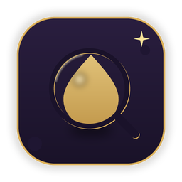

<div align="center">



# 甘露解析 · LGAnalysis

**粘贴网盘分享链接 / 视频链接，直接高速下载 —— 开源的 Android + Windows 双端解析下载工具**

网盘：夸克 / UC / 迅雷 / 百度 / 139 / 123 / 115 / 光鸭 / 蓝奏云 / 蓝奏云优享版，自动识别分享链接并匹配提取码；
视频：抖音 / 小红书 / 快手 / 微博 / AcFun / 哔哩哔哩 / Pixiv；桌面端另支持磁力 / BT 种子 / ed2k。
Range 分片并发 + 断点续传，凭证本机加密保存，多账号管理。

</div>

---

> 本仓库为甘露解析的**统一仓库**：`android/` 为 Android 端，`desktop/` 为 Windows 桌面端（含浏览器扩展），最终发布产物统一放在根目录 `release/`。

## 功能一览

- **网盘分享链接解析** —— 识别十个网盘平台的分享链接，自动匹配提取码，浏览分享内容并取下载直链
- **视频链接解析** —— 短视频 / 图集 / 视频作品免登录直出直链；B 站登录后画质更高、音视频分轨自动合轨；Pixiv 粘贴浏览器 Cookie 可解析全部作品
- **高速下载** —— Range 分片并发（上限 32）+ 断点续传 + 全局/单任务限速；HLS 合并；桌面端磁力 / BT / ed2k 走独立 P2P 引擎
- **在线预览** —— 图片 / 视频 / 音频逐请求带 Referer / Cookie 在线播放，直链不再 403
- **多账号与凭证安全** —— WebView / 内嵌浏览器登录 Cookie、账密换 JWT、账号密码 / 短信多形态；口令派生密钥 AES-GCM 本机加密，支持加密备份换机恢复
- **浏览器扩展**（桌面端）—— Chrome / Edge 扩展接管浏览器下载到多线程下载引擎

## 目录结构

```
LGAnalysis/
├── android/            Android 端（Kotlin + Jetpack Compose）
├── desktop/            Windows 桌面端（Compose Multiplatform，含 browser-extension/ 浏览器扩展）
├── release/            最终发布产物（安装包 / APK / 便携版统一放这里）
└── research/           前期研究与内部文档
```

## 构建与发布

- Android：Android Studio 打开 `android/` 直接构建；产物 APK 发布时归档到根目录 `release/`
- Windows：`desktop/` 内 `run.ps1` 本地运行，`installer-package.ps1` / `portable-package.ps1` 打安装版与便携版

## 交流

- QQ 交流群：**335753296**（[加群链接](https://qm.qq.com/q/soFNtWRytq)）
- 问题反馈请开 [Issue](https://github.com/PointersMZX/LGAnalysis/issues)

## 版权

Copyright © 2026 LGAnalysis All Rights Reserved
